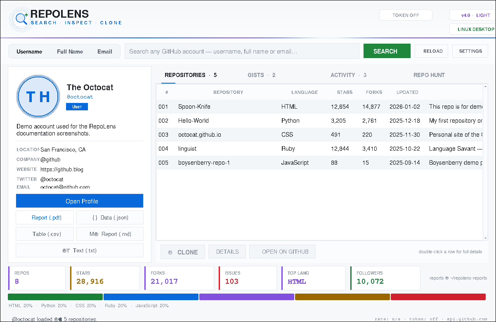
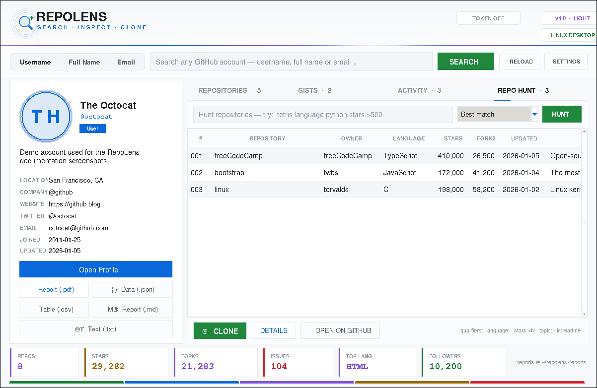
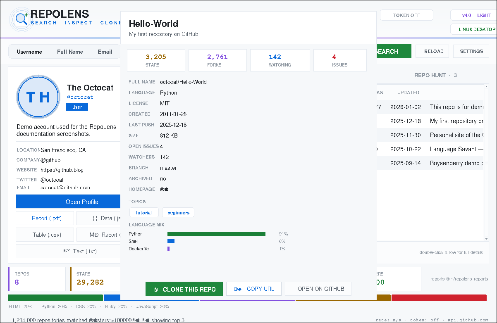
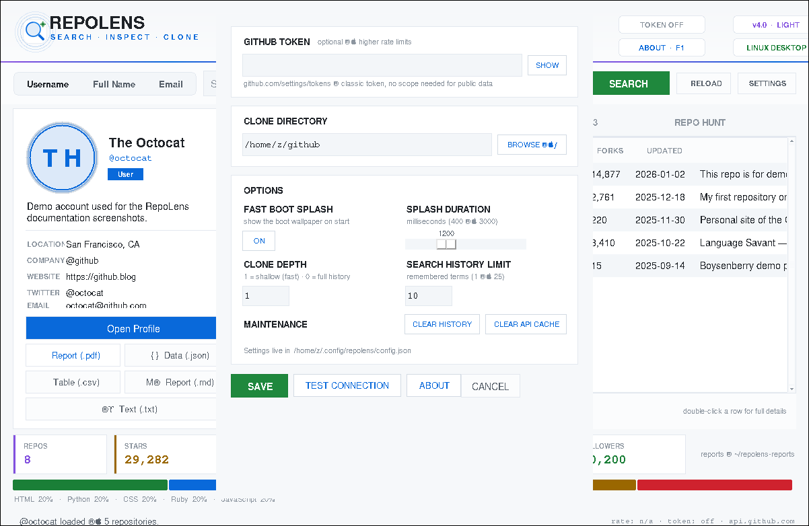
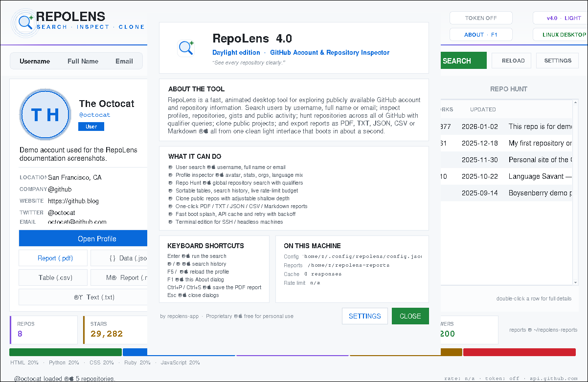
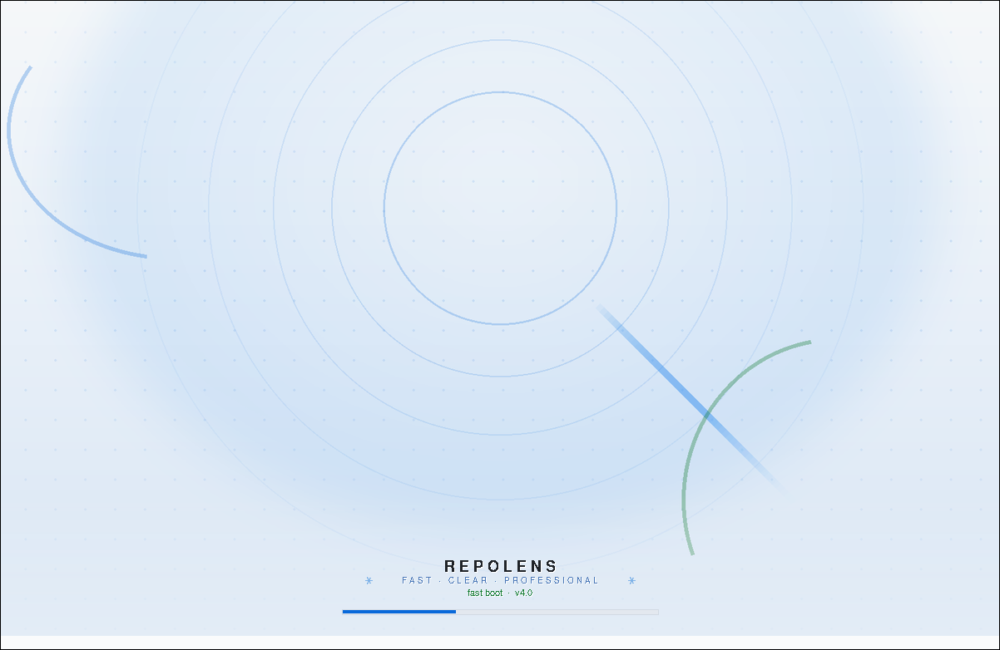

 <div align="center">


# RepoLens v4.0

### GitHub Account & Repository Inspector

**Explore. Discover. Inspect.**

A powerful Linux application to search, analyze, inspect, and clone public GitHub repositories.


**Search • Inspect • Clone • Export**

</div>

---

## Overview

**RepoLens** is a modern Python-based GitHub Account and Repository Inspector designed for Linux. It provides a powerful graphical interface and command-line experience to explore GitHub profiles, analyze repositories, discover projects, and generate detailed reports.

Featuring a professional Daylight Light UI, fast startup, advanced repository search, and multiple export formats, RepoLens makes GitHub exploration simple and efficient.

## Features

- **GitHub Account Search** – Search and inspect public GitHub profiles.
- **Profile Analytics** – View followers, repositories, stars, forks, and organizations.
- **Repository Explorer** – Explore repository details, languages, topics, and statistics.
- **Repo Hunt** – Discover public repositories using advanced GitHub search qualifiers.
- **Gists Explorer** – Browse publicly available GitHub gists.
- **Activity Monitor** – Explore recent public GitHub activities.
- **Repository Cloning** – Clone selected public repositories directly.
- **Multiple Export Formats** – Generate PDF, TXT, JSON, CSV, and Markdown reports.
- **Smart API Handling** – Response caching, automatic retries, and rate-limit monitoring.
- **Search History** – Quickly revisit previous searches.
- **Modern GUI** – Professional Daylight Light interface.
- **CLI Support** – Full terminal-based functionality.
- **Fast Startup** – Optimized 1.2-second boot splash.

## Screenshots

<div align="center">

### Main Dashboard



### Repository Discovery



### Repository Details



### Application Settings



### About & Startup





</div>

## Requirements

- Linux operating system
- Python 3
- Python Tkinter
- Git
- Internet connection

### Install Dependencies

```bash
sudo apt update

sudo apt install -y python3 python3-tk git xdg-utils curl
```

Optional image support:

```bash
python3 -m pip install --user Pillow
```

## Installation

**1. Clone the repository**

```bash
git clone https://github.com/silent-days/Repolens.git
```

**2. Enter the project directory**

```bash
cd Repolens/repolens-v4
```

**3. Run the installer**

```bash
sudo bash install.sh
```

**4. Launch RepoLens**

```bash
repolens
```

Alternative command:

```bash
rl
```

## Quick Start (Without Installation)

Run RepoLens directly from its project directory:

```bash
cd Repolens/repolens-v4
bash run.sh
```

Launch the CLI:

```bash
python3 repolens-cli.py
```

## Usage

| Command | Description |
|---|---|
| `repolens` | Launch GUI |
| `rl` | Launch GUI using alias |
| `repolens octocat` | Search GitHub account |
| `repolens --cli` | Launch terminal interface |
| `repolens --cli octocat` | Search account in CLI |
| `repolens --cli --repos 'tetris language:python stars:>500'` | Search repositories |
| `repolens --cli --about` | Display application information |
| `repolens --version` | Display version |

## GitHub API Token

A GitHub Personal Access Token is optional.

Without authentication, GitHub applies its unauthenticated API rate limits. Adding a token can increase the available API rate limit.

1. Generate a token from [GitHub Settings](https://github.com/settings/tokens).
2. Open RepoLens.
3. Navigate to Settings.
4. Enter your token and save.

**Configuration location:**

```text
~/.config/repolens/config.json
```

Keep your API token private. Never publish it or include it in screenshots.

## Reports & Storage

| Item | Location |
|---|---|
| Reports | `~/repolens-reports/` |
| Configuration | `~/.config/repolens/config.json` |
| Clone Directory | `~/github/` |
| Installed Application | `/opt/repolens/` |

## Troubleshooting

**GUI not opening**

```bash
sudo apt install python3-tk
bash doctor.sh
```

**Run manually**

```bash
python3 repolens_gui.py
```

**GitHub API rate limit reached**

Configure an optional GitHub API token in Settings.

**Running through SSH or without a desktop**

```bash
python3 repolens-cli.py
```

**Uninstall RepoLens**

From the application directory:

```bash
sudo bash install.sh --uninstall
```

The uninstaller keeps user configuration and generated reports.

## Security & Responsible Use

RepoLens uses the official GitHub REST API to access publicly available GitHub information.

- Does not bypass GitHub access controls.
- Respects public API limitations.
- Does not provide unauthorized private repository access.
- Keeps API token configuration separate from application source files.

Use RepoLens responsibly and respect GitHub's terms and repository owners' rights.

## License

**RepoLens is proprietary software.**

All rights are reserved by the copyright holder. Public repository visibility does not grant permission to redistribute, modify, sublicense, or commercially exploit this software.

See the [LICENSE](LICENSE) file for complete terms.

## Support

Found a bug or issue?

Open an issue on GitHub:

[Report an Issue](https://github.com/silent-days/Repolens/issues)

---

<div align="center">

### REPOLENS · DAYLIGHT EDITION

**Explore. Discover. Inspect.**

Developed by **[@silent-days](https://github.com/silent-days)**

</div>
