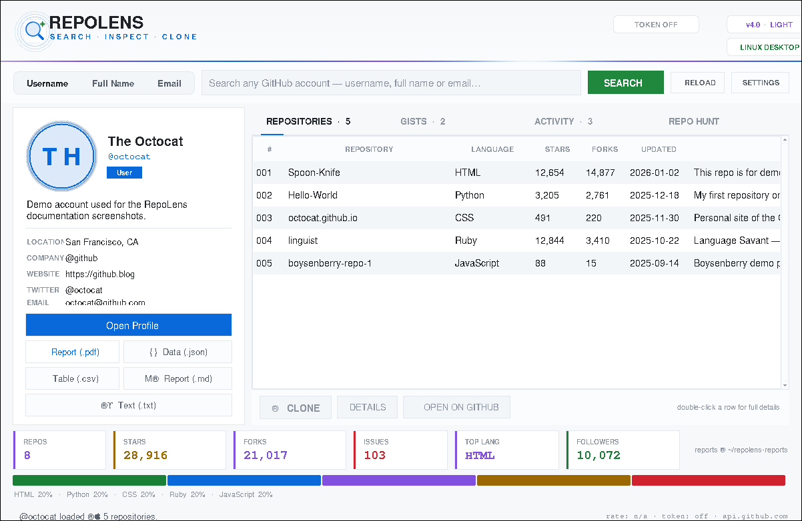
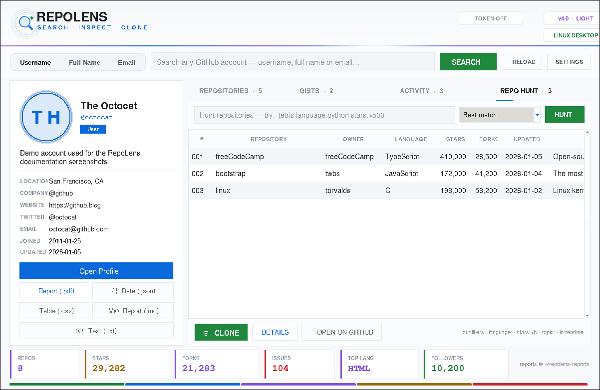
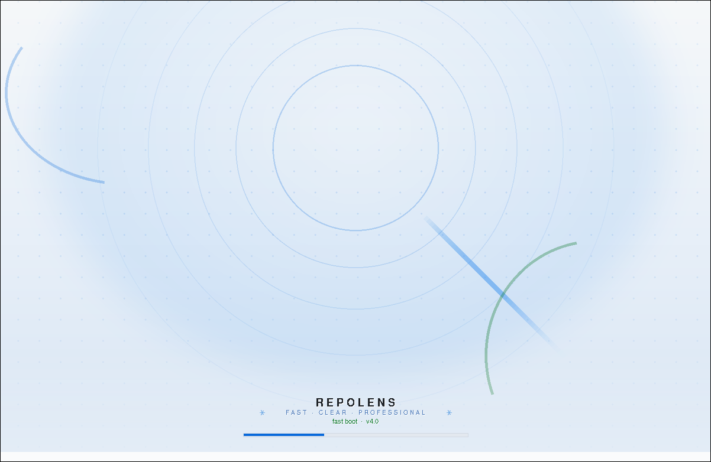
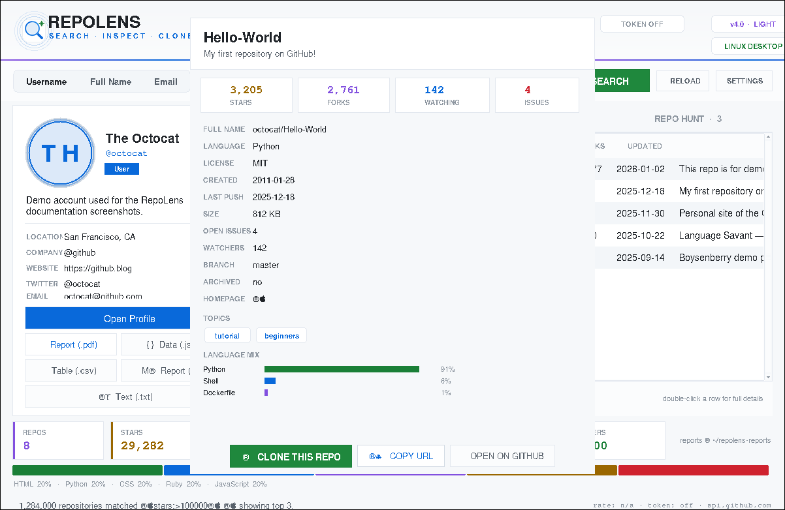
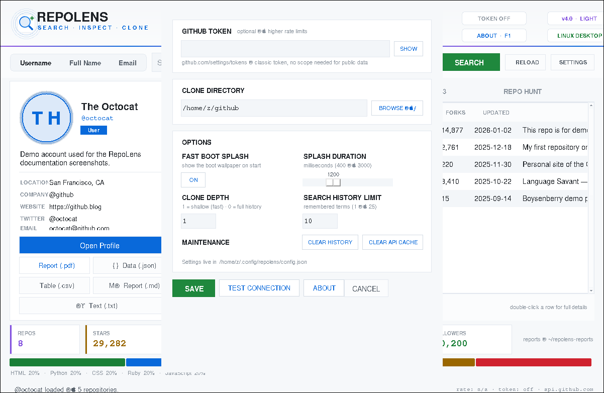
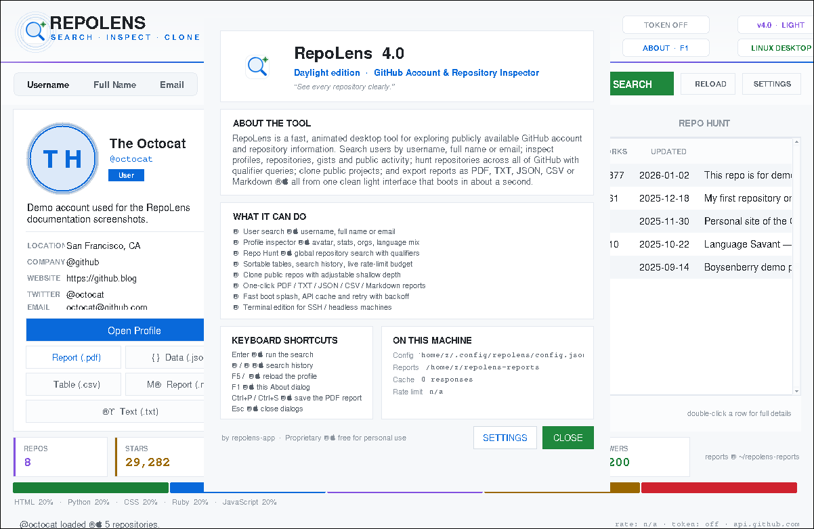

# REPOLENS v4.0

**GitHub Account & Repository Inspector · Desktop GUI for Linux**

*✨ See every repository clearly.*

  
  
  
  

**Search · Inspect · Clone · Export**

[Repository](https://github.com/repolens-app/RepoLens) · [Issues](https://github.com/repolens-app/RepoLens/issues)

---

## Overview

RepoLens is a Python desktop application for searching GitHub users and exploring their publicly available profile and repository information. Search by username, full name, or email; inspect repositories, gists and recent public activity; hunt repositories across all of GitHub; clone repositories; and export reports as a polished **PDF**, TXT, JSON, CSV or Markdown.

The v4.0 "daylight" upgrade is a **complete rebrand + reskin**. GitHub Search is now **RepoLens** — new name, new lens logo, new icon, new boot wallpaper, one identity everywhere (GUI, CLI, PDF reports, installer, docs). The interface is the new **Daylight Light** theme: a soft daylight canvas, clean white cards, gentle borders, an azure signal color, and light-safe accents on every chip, table and chart — smooth and professional without glare. **Fast boot** drops the startup splash from 3 seconds to a quick **1.2 seconds**; the wallpaper still fades in, shows an animated progress bar and **melts into the app background** (cover-fit scaling, painted before the window maps, zero flicker). The **PDF report engine now writes a light A4 document** — azure header band with the lens mark, light stat chips, readable tables — and the PDF download flow stays bullet-proof: a native **Save-As dialog** (defaults to your Downloads folder), a **background-thread build** so the interface never freezes, and a reveal-in-folder prompt straight from the success message. Everything from earlier versions stays: the Repo Hunt engine, sortable tables, search history, language analytics, five export formats, a live rate-limit budget, an API response cache with automatic retry, and the same consistent motion system (120 / 220 / 320 ms). Profile avatars render as perfect circles inside a glowing ring.

## Features

| Feature | What it does |
|---|---|
| User search | Search by GitHub username, full name, or email |
| **Repo Hunt** *(new)* | Search every public repository on GitHub — supports qualifier queries like `tetris language:python stars:>500` |
| Profile inspector | View public profile details, avatar, followers, and organizations |
| Repository explorer | Browse repositories with stars, forks, language, topics, and update dates |
| **Sortable tables** *(new)* | Click any column heading in every table to re-sort instantly |
| **Search history** *(new)* | Press ↑ / ↓ in the search box to flip through your last 10 lookups |
| **Language analytics** *(new)* | Live language-mix bar under the stats chips + per-repo language breakdown |
| Repository details | Inspect license, size, issues, topics, homepage — and copy the URL or clone right from the dialog |
| Clone | Shallow-clone a selected public repository |
| Browser | Open a GitHub profile, gist, or repository in the browser |
| Gists and activity | Browse public gists and recent public events |
| Reports | Save human-readable TXT reports and structured JSON exports |
| **PDF reports** | One click produces a polished A4 PDF — light azure header with the lens mark, stats chips, language-mix bar, repository table, gists and activity. Built-in engine, no external libraries. Save-As dialog (defaults to Downloads), background-thread build so the UI never freezes, reveal-in-folder prompt |
| **CSV & Markdown exports** | One-click spreadsheet table and rich Markdown report |
| **Smart core** *(new)* | API response cache, automatic retry with backoff, live rate-limit budget in the status bar |
| **Refresh** *(new)* | Re-fetch the loaded profile with a cold cache (F5 / ↻) |
| Settings | Configure a token, clone directory, boot splash (on/off + duration), clone depth, history limit — and clear the history or API cache |
| About | Press **F1** (or the ABOUT pill in the header) for the full tool guide inside the app |
| GUI | Daylight Light theme (soft daylight canvas · white cards · azure signal) |
| Startup splash | Lens Glow wallpaper boot screen for a fast 1.2 seconds with progress bar and the "FAST · CLEAR · PROFESSIONAL" tagline |

Screenshots:

| Repo Hunt | Fast boot splash |
|---|---|
|  |  |

| Repository details | Settings |
|---|---|
|  |  |

| About dialog | — |
|---|---|
|  | |

## Requirements

- Linux or a compatible Debian-based Linux distribution with a desktop session
- Python 3
- Tkinter for the graphical interface
- Git for repository cloning
- Internet connection
- Pillow is optional; it improves compatibility with JPEG/WebP avatars and image scaling

Install the system dependencies:

~~~bash
sudo apt update
sudo apt install -y python3 python3-tk git xdg-utils
~~~

Optional Pillow support:

~~~bash
python3 -m pip install --user Pillow
~~~

## Installation

### 1. Clone this repository

~~~bash
git clone https://github.com/repolens-app/RepoLens.git
~~~

### 2. Enter the application directory

~~~bash
cd RepoLens/repolens-v4
~~~

### 3. Install RepoLens

~~~bash
sudo bash install.sh
~~~

The installer checks for Linux, installs missing system dependencies, copies the application and its runtime image assets to **/opt/repolens**, creates the **repolens** command (with the short **rl** alias), and adds an Applications menu entry.

For another Debian-based distribution, use the explicit override:

~~~bash
sudo bash install.sh --force
~~~

### Quick launch without installing

From the application directory:

~~~bash
bash run.sh
~~~

The launcher checks Python, Tkinter, and the display environment. The splash PNG must remain in the assets directory beside the application source.

### Remote one-line installer

~~~bash
curl -fsSL https://raw.githubusercontent.com/repolens-app/RepoLens/main/repolens-v4/remote-install.sh -o remote-install.sh
sudo bash remote-install.sh
~~~

Only run installation scripts from a source you trust. To review the script first, open the remote-install.sh file in this repository before executing it.

## Commands

After installation:

| Command | Action |
|---|---|
| **repolens** | Start the GUI |
| **rl** | Short alias for `repolens` |
| **repolens octocat** | Open the GUI and search for a username |
| **repolens --about** | Show the full tool information (name, version, features, paths) |
| **repolens --cli** | Start the terminal edition |
| **repolens --cli octocat** | Search a username in terminal mode |
| **repolens --cli --repos 'tetris language:python stars:>500'** | Repo Hunt in terminal mode |
| **repolens --cli --about** | Show the tool information in the terminal |
| **repolens --help** | Show GUI usage information |
| **repolens --version** | Show the application version |
| **sudo bash install.sh --uninstall** | Remove the installed application |

Without installing, from the application directory:

~~~bash
bash run.sh
bash run.sh octocat
bash run.sh --cli
python3 repolens-cli.py
python3 repolens-cli.py octocat
python3 repolens_gui.py --help
python3 repolens_gui.py --version
~~~

The GUI requires a working Linux desktop display. The terminal edition can be used over SSH or on headless systems.

## Using the GUI

1. Choose **Username**, **Full Name**, or **Email** search mode.
2. Enter the search term and press Enter or click **SEARCH** (↑ / ↓ recalls recent searches).
3. Review the profile card, avatar, account details, statistics and the language-mix bar.
4. Open the **Repositories**, **Gists**, or **Activity** tabs — click a heading to sort.
5. Select a repository to view details, clone it, copy its URL, or open it on GitHub.
6. Use the export buttons for **PDF** (Ctrl+P / Ctrl+S), JSON, CSV, Markdown or TXT.
7. Switch to the **Repo Hunt** tab to search all of GitHub's public repositories; refine with qualifiers like `language:python stars:>1000` and sort the results.
8. Press **F5** or click **↻ RELOAD** to refresh the loaded profile with a cold cache.
9. Open **Settings** to configure a token or clone directory, toggle the fast boot splash and its duration, set the clone depth, cap the search history, and clear the history or the API cache — every option saves to `~/.config/repolens/config.json` and takes effect immediately.
10. Press **F1** or click the **ABOUT · F1** pill in the header for the full tool information: what the tool does, its features, every keyboard shortcut, and where your config, reports and cache live on this machine.

## GitHub API token (optional)

RepoLens can query public GitHub information without a token, subject to GitHub's unauthenticated rate limits. An optional personal access token can provide a higher API rate limit.

1. Create a token in [GitHub Settings](https://github.com/settings/tokens).
2. Open **Settings** in RepoLens.
3. Paste the token and select **Save**.

The application stores its configuration at:

**~/.config/repolens/config.json**

The configuration file is written with owner-only permissions (0600). Never share your token or commit it to this repository.

## Reports and configuration

Reports are saved in:

**~/repolens-reports/**

The configuration file is saved in:

**~/.config/repolens/config.json**

The clone directory defaults to:

**~/github/**

## Project structure

~~~text
RepoLens/
├── README.md
├── LICENSE
└── repolens-v4/
    ├── repolens_gui.py
    ├── repolens-cli.py
    ├── repolens_core.py
    ├── install.sh
    ├── run.sh
    ├── remote-install.sh
    ├── doctor.sh
    ├── README.md
    ├── assets/
    │   ├── repolens-icon.png
    │   ├── repolens-logo.png
    │   └── repolens-splash.png
    └── docs/
        ├── screenshot-main.png
        ├── screenshot-hunt.png
        ├── screenshot-details.png
        └── screenshot-settings.png
~~~

## Troubleshooting

### GUI does not open

~~~bash
sudo apt update
sudo apt install -y python3 python3-tk
bash doctor.sh
~~~

Run from the application directory to see startup errors:

~~~bash
python3 repolens_gui.py
~~~

### Splash image is missing

Confirm the following file exists:

**assets/repolens-splash.png**

If running the installed application, confirm the installer copied it to:

**/opt/repolens/assets/repolens-splash.png**

Reinstall from the project directory after updating:

~~~bash
sudo bash install.sh
~~~

### GitHub avatar does not display

Check your internet connection. For broader image-format support, install Pillow:

~~~bash
python3 -m pip install --user Pillow
~~~

### GitHub rate limit reached

Wait for the rate limit to reset or configure a personal access token in Settings. Do not paste tokens into issues, screenshots, or public messages.

### No display / SSH / headless system

The GUI needs a desktop session. Use terminal mode instead:

~~~bash
python3 repolens-cli.py
~~~

### Launcher command not found

Open a new terminal after installation and check that **/usr/local/bin** is in your PATH. You can also run the application directly with:

~~~bash
bash run.sh
~~~

## Security and responsible use

RepoLens uses the official GitHub REST API to retrieve information made publicly available by GitHub. It does not bypass private repository permissions. Respect GitHub's Terms of Service, API limits, and user privacy. Keep access tokens private.

## Version history

### v4.0 — "daylight" *(current)*

- **Full rebrand — RepoLens:** GitHub Search is now **RepoLens** — new name, new azure lens logo and app icon, new Lens Glow boot wallpaper, one identity across the GUI, CLI, PDF reports, installers and docs. Command launchers are `repolens` (short alias `rl`), config lives in `~/.config/repolens/`, reports in `~/repolens-reports/`.
- **Daylight Light theme:** a full professional light reskin — soft daylight canvas (`#F6F8FA`), clean white cards, gentle borders, azure signal (`#0969DA`), light-safe accents on every chip, table, chart and PDF report.
- **Fast boot:** the startup splash dropped from 3 s to **1.2 s** — the fade-in, progress bar and melt-into-the-UI choreography are unchanged, they just no longer make you wait.
- **Light PDF reports:** the built-in engine now writes a crisp light A4 document — azure header band with the lens mark, light stat chips with hairline outlines, readable dark-on-white tables. The engine stays fully defensive (safe defaults for every field, explicit `out=` path support) and the Save-As → background-thread → reveal-folder flow is unchanged.
- All v3 features stay: Repo Hunt, sortable tables, search history, language analytics, TXT / JSON / CSV / Markdown / PDF exports, smart cache, retry with backoff and the live rate-limit display.

### v3.0 — "frostfall"

- **Fixed — the stuck PDF button:** the **Report (.pdf)** button was accidentally left out of the list of export buttons enabled after a profile load, so it stayed grey and unclickable while every other export worked. It now activates together with the others (profile card + Ctrl+P / Ctrl+S).
- **Real download flow for the PDF report:** clicking Report (.pdf) first opens a native **Save-As dialog** (default name `username-report.pdf`, default folder `~/Downloads`, falling back to `~/repolens-reports`), then the report builds on a **background thread** — the interface stays perfectly responsive even with hundreds of repositories — and a success prompt offers to **open the containing folder**.
- **Bullet-proof PDF engine:** every profile, repository, gist and activity field is read with safe defaults in the core `save_pdf()`, so cached or unusual data can no longer raise.
- **Renderer hardening:** repository, gist and activity tables in the GUI tolerate missing fields gracefully instead of raising.

### v2.1 — "arctic" *(historical release — dark-era branding)*

- **PDF reports (GUI + CLI):** the primary **Report (.pdf)** button (and Ctrl+P / Ctrl+S) writes a polished A4 PDF to `~/repolens-reports/` — branded header band, profile facts card, stats chips, language-mix bar, zebra-striped repository table with descriptions and topics, gists and recent activity, page footers with numbering. Written by a tiny built-in PDF engine (PDF 1.4, core fonts, WinAnsi) — **zero external dependencies**.
- **Boot wallpaper refresh** with a matching boot caption tagline and a `[p] PDF report` action in the CLI profile view.
- **Profile card fix:** export buttons are now packed bottom-first, so every export button stays visible even on short windows; the default window height grew to 840 px.

### v2.0 — "power pack"

- **Repo Hunt tab:** search every public repository on GitHub with qualifier queries (`language:`, `stars:>N`, `topic:`, `in:readme`), sort by best match / stars / forks / recent updates, and clone or inspect results directly.
- **Sortable tables:** every table (Repositories, Gists, Activity, Repo Hunt) re-sorts instantly when you click a column heading.
- **Search history:** the last 10 lookups are remembered — press ↑ / ↓ in the search box to flip through them.
- **Language analytics:** a live language-mix bar under the stats chips and a per-repository language-bytes breakdown in the details dialog.
- **More exports:** CSV (spreadsheet table) and Markdown (rich report) join the classic TXT and JSON formats.
- **Smart core layer:** API responses are cached (300 s normal / 90 s search endpoints), transient network and 5xx failures retry automatically with backoff, and the status bar shows the live rate-limit budget (`rate: 41/60`).
- **Refresh:** F5 / ↻ re-fetches the loaded profile with a cold cache.
- **Richer repo details:** open issues, watchers, default branch, archived flag, a CLONE button and a COPY-URL button in the dialog.
- **New stats chips:** ISSUES joins REPOS / STARS / FORKS / TOP LANG / FOLLOWERS.
- Terminal edition gains Repo Hunt (`--repos` / `r`) plus CSV and Markdown exports.

### v1.0 — first dark-era release *(historical)*

- **Full redesign:** animated dark interface with an emerald signal, azure links and violet spark highlights; a consistent motion system (120 / 220 / 320 ms) shared by hovers, tab underline, search-mode knob, boot reveal and toasts.
- **Animated header entrance:** the brand slides in from the left and the status pills from the right each time the app appears.
- **In-app boot splash:** the window opens at its normal size and the wallpaper fills the window (cover-fit scaling, upscaled with Pillow when needed) with an animated progress bar. The boot is painted before the window maps (first frame = wallpaper, zero flicker) and then melts smoothly into the app background instead of hard-swapping. The boot screen lives inside the app window — no fullscreen takeover, and it follows window resizes while booting.
- **Circular profile avatar:** photos are clipped to a perfect circle with an anti-aliased mask and wrapped in a glowing accent ring; the fallback initials render on a circle too.
- Search started from the command line now runs after the splash finishes.
- Settings dialog height increased so all controls fit.

## License

**RepoLens is proprietary software.** All rights are reserved by the copyright holder. Viewing the source and personal evaluation are permitted. Copying, modifying, redistributing, sublicensing, or creating derivative works requires prior written permission.

See the [Proprietary License](LICENSE) in this directory. This project is **not** distributed under the MIT License.

## Support

Found a bug? Open an [issue](https://github.com/repolens-app/RepoLens/issues) and include your Linux distribution, Python version, launch command, and relevant error output. Remove tokens and other secrets before sharing logs.

---

**REPOLENS · DAYLIGHT EDITION**

*Explore · Discover · Inspect*

Developed by [@repolens-app](https://github.com/repolens-app)

**Happy Searching.**

